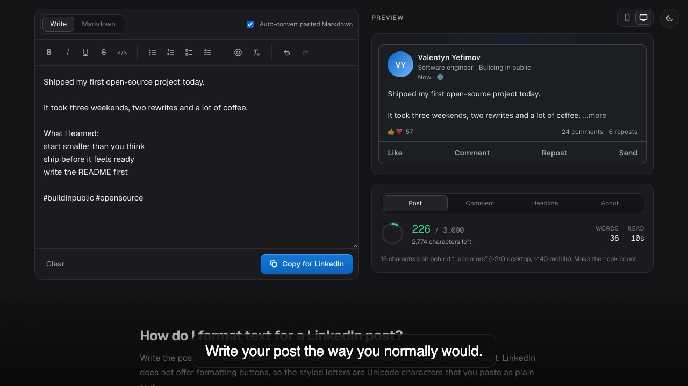

# LinkedIn Text Formatter

**Live: [linkedin.yefimov.tech](https://linkedin.yefimov.tech)**


[](docs/demo.mp4)

*Click the poster to watch the 87-second demo (narrated, with captions and music).*

Write LinkedIn posts with **bold**, *italic*, underline, strikethrough, `monospace` code and lists,
convert Markdown to LinkedIn-ready text, and preview the post as it will look in the feed.

LinkedIn has no rich text, so styles are Unicode look-alike characters
(Mathematical Alphanumeric Symbols and combining marks). They are not searchable and are read
poorly by screen readers. Use them for emphasis.

Built by [Valentyn Yefimov](https://yefimov.tech) · [GitHub](https://github.com/valyefimov) · [yefimov.tech](https://yefimov.tech)

## Features

- Toolbar and shortcuts (`⌘B`, `⌘I`, `⌘U`, `⌘⇧X`, `⌘E`) that act on the selection or the word at the caret
- Bullet, numbered, checklist and arrow lists; emoji and glyph picker
- Markdown mode: headings, bold/italic, strikethrough, lists, task lists, quotes, tables, links, code.
  Code can be rendered monospace or bold. Pasted Markdown is converted automatically (undoable)
- Live limits for posts (3000), comments (1250), headlines (220) and About (2600), and the “…see more” fold
- Feed preview with mobile and desktop widths, hashtag/mention/link highlighting
- Drafts are stored in `localStorage`; nothing leaves the browser

## Development

```bash
npm install
npm run dev        # http://localhost:3000
npm test           # unit tests for the text engine
npm run typecheck
npm run build
```

## Demo video

`docs/demo.mp4` is generated from the real app, so it can be rebuilt whenever the UI changes:

```bash
npm run demo        # build, capture the UI with Puppeteer, narrate with termdub, mix music
```

Needs Google Chrome, `ffmpeg` and the free `edge-tts` voice (`pip install edge-tts`). The pipeline lives in
[scripts/demo](scripts/demo): `capture.mjs` drives the app and saves frames, `build.mjs` writes the narration and
burned-in captions with [termdub](https://github.com/valyefimov/termdub), and `music.mjs` synthesises the ambient
track that ducks under the voice.

## Deploy

The app is a standard Next.js project; import the repository in Vercel (or run `npx vercel`).
No environment variables are needed.

See [CLAUDE.md](CLAUDE.md) for architecture and [DESIGN.md](DESIGN.md) for the design system.
